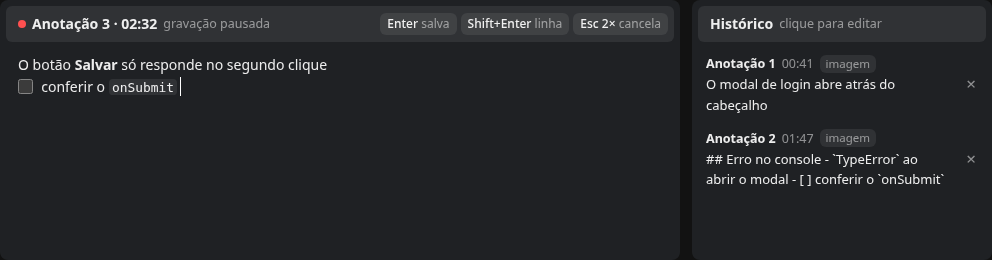

<div align="center">


# Nino

**Grave a tela, tire prints e anote o que importa para a IA, tudo de uma vez.**<br>
Fork do [Ahri](https://github.com/juicerq/ahri) para KDE Plasma no Wayland, em Rust.


</div>

<br>

## Como funciona

1. <kbd>Win</kbd> <kbd>R</kbd> e arraste uma caixa. A gravação começa quando você solta o mouse.
2. <kbd>Win</kbd> <kbd>N</kbd> (ou <kbd>Win</kbd> <kbd>Shift</kbd> <kbd>S</kbd>) pausa a gravação e abre a anotação daquele instante:
   - a tela congela com o menu de desenho do Ahri e a área gravada já selecionada;
   - o cartão de comentário e o histórico das anotações anteriores aparecem fora da área e ficam visíveis até você salvar;
   - clique na tela para desenhar, clique no cartão para escrever;
   - <kbd>Enter</kbd> salva a imagem, o comentário e o tempo e retoma a gravação.
3. <kbd>Win</kbd> <kbd>R</kbd> de novo, ou <kbd>Esc</kbd> duas vezes seguidas, para parar. O primeiro <kbd>Esc</kbd> continua chegando ao app em uso.
4. Um painel de revisão abre com o vídeo tocando. Escolha as faixas de áudio, a qualidade e o corte, e aperte <kbd>Enter</kbd> para copiar a sessão.

Durante a anotação, <kbd>Esc</kbd> duas vezes cancela a gravação inteira e apaga os arquivos dela.

O tempo das anotações é o do vídeo: as pausas não contam. Para anotar só com texto, clique uma vez fora da área para tirar a seleção. Os cartões e o histórico nunca entram na imagem.

Ao parar sem nenhum comentário, o clipboard recebe os arquivos: o vídeo e os prints das anotações. Se alguma anotação tiver comentário, recebe só o texto da sessão, com o caminho completo de cada arquivo:

```text
Vídeo: /tmp/nino/2026-11-18_14-03-22/gravacao.mp4

Anotação 1 - 02:32 (/tmp/nino/2026-11-18_14-03-22/anotacao-1.png): "O **botão** salvar não responde"
Anotação 2 - 03:11: "Ver o `console`"
```

Tudo fica em `/tmp/nino/`, que some quando o computador reinicia.

## Áudio

O ícone do Nino fica na área oculta da bandeja. Nele há dois interruptores, que valem a partir da próxima gravação:

- **Som do PC**: tudo que toca na saída de som padrão;
- **Microfone**: a entrada padrão, com redução de chiado e zumbido no vídeo final.

Cada um vira uma faixa separada. Se o gravador recusar algum dispositivo, a gravação recomeça sem áudio.

## Revisão

O painel mostra a onda de cada faixa gravada, então dá para ver se o microfone pegou algo. As faixas ligadas na bandeja começam ligadas. O vídeo final é preparado em segundo plano enquanto você assiste.

| Tecla | Ação |
| --- | --- |
| <kbd>Espaço</kbd> | Tocar ou pausar |
| <kbd>1</kbd> e <kbd>2</kbd> | Ligar ou desligar o som do PC e o microfone |
| <kbd>↑</kbd> e <kbd>↓</kbd> | Trocar a qualidade |
| <kbd>←</kbd> e <kbd>→</kbd> | Voltar ou avançar 1 segundo |
| <kbd>I</kbd> e <kbd>O</kbd> | Cortar o início ou o fim no ponto atual |
| <kbd>Ctrl</kbd> <kbd>C</kbd> ou <kbd>Enter</kbd> | Salvar e copiar a sessão |
| <kbd>Esc</kbd> | Descartar o vídeo e copiar só as anotações |

Arraste as alças amarelas da barra para cortar com o mouse, ou clique na barra para pular para um ponto. Os tempos das anotações acompanham o corte do início.

Fora de uma gravação, <kbd>Win</kbd> <kbd>Shift</kbd> <kbd>S</kbd> funciona como no Ahri: o print vai direto para o clipboard.

## Anotação

<p align="center"></p>

O campo usa o editor do composer do [T3 Code](https://github.com/pingdotgg/t3code), só com a formatação. O Markdown vira formatação enquanto você digita: `# título`, `---`, `> citação`, `- lista`, `1. lista`, `- [ ] tarefa`, ```` ``` ```` para bloco de código, `**negrito**`, `*itálico*`, `~~riscado~~` e `` `código` ``. Os marcadores reaparecem quando o cursor entra no trecho, e o comentário sai em Markdown.

| Tecla | Ação |
| --- | --- |
| <kbd>Enter</kbd> | Salvar e retomar a gravação |
| <kbd>Shift</kbd> <kbd>Enter</kbd> | Nova linha |
| <kbd>Enter</kbd> numa lista | Novo item |
| <kbd>Ctrl</kbd> <kbd>Enter</kbd> | Salvar de qualquer lugar |
| <kbd>Esc</kbd> <kbd>Esc</kbd> | Cancelar a gravação e apagar os arquivos |

No histórico, clique numa anotação para editá-la: a tela volta à imagem daquele momento, com os desenhos, e o comentário volta ao cartão. <kbd>Enter</kbd> salva a edição e retoma a gravação. O <kbd>×</kbd> apaga a anotação, e as seguintes são renumeradas.

## Print


| Tecla | Ação |
| --- | --- |
| <kbd>1</kbd> ou <kbd>A</kbd> | Desenhar |
| <kbd>2</kbd> ou <kbd>D</kbd> | Seta |
| <kbd>3</kbd> ou <kbd>Q</kbd> | Quadrado |
| <kbd>4</kbd> ou <kbd>W</kbd> | Quadrado pintado |
| <kbd>5</kbd> ou <kbd>E</kbd> | Círculo |
| <kbd>6</kbd> ou <kbd>R</kbd> | Círculo pintado |
| <kbd>7</kbd> ou <kbd>B</kbd> | Desfocar uma área; o controle abaixo da barra ajusta a intensidade |
| <kbd>8</kbd> | Abrir as cores, depois <kbd>1</kbd>–<kbd>6</kbd> para escolher |
| <kbd>8</kbd> <kbd>7</kbd> | Conta-gotas: clique em qualquer ponto da tela para usar aquela cor |
| <kbd>C</kbd> | Próxima cor |
| <kbd>Ctrl</kbd> <kbd>Z</kbd> | Desfazer |
| <kbd>Ctrl</kbd> <kbd>C</kbd> ou <kbd>Enter</kbd> | Copiar e fechar |
| <kbd>Esc</kbd> | Cancelar |

## Instalação

Precisa de KDE Plasma 6 no Wayland, Rust, [bun](https://bun.sh), [gpu-screen-recorder](https://git.dec05eba.com/gpu-screen-recorder/about/), FFmpeg, gtk-layer-shell e WebKitGTK.

```sh
sudo pacman -S gpu-screen-recorder ffmpeg gtk-layer-shell webkit2gtk-4.1
git clone https://github.com/pedrinhopagan/nino
cd nino
./install.sh
```

O script instala o binário em `~/.local/bin`, registra o Nino no KWin e liga um serviço systemd de usuário. <kbd>Win</kbd> <kbd>Shift</kbd> <kbd>S</kbd> e <kbd>Win</kbd> <kbd>R</kbd> passam do Spectacle para o Nino; o Spectacle continua no <kbd>Print</kbd> e no <kbd>Win</kbd> <kbd>Shift</kbd> <kbd>R</kbd>.

<details>
<summary>Remover</summary>

```sh
systemctl --user disable --now nino
rm ~/.local/bin/nino ~/.local/share/applications/nino.desktop \
   ~/.local/share/icons/hicolor/scalable/apps/nino.svg ~/.config/systemd/user/nino.service
```

</details>

## Por baixo

| Parte | Como |
| --- | --- |
| Captura | `org.kde.KWin.ScreenShot2`, liberado pelo `.desktop` |
| Overlay | layer-shell com [smithay-client-toolkit](https://github.com/Smithay/client-toolkit) e [tiny-skia](https://github.com/linebender/tiny-skia) |
| Anotação | janela layer-shell com WebKitGTK e [Tiptap](https://tiptap.dev), aberta como subprocesso `nino editor` |
| Atalhos | kglobalaccel por D-Bus |
| Clipboard | `ext-data-control`, servido pelo próprio daemon |
| Gravação | `gpu-screen-recorder` em H.264, na GPU quando dá e na CPU quando não dá |
| Revisão | FFmpeg toca a prévia, desenha a onda e prepara o vídeo final |
| Opções | Plasmoid na bandeja, com arquivos em `~/.config/nino/` |
| Revisão | FFmpeg toca a prévia, desenha a onda e prepara o vídeo final |

## Créditos

Base de captura, overlay e gravação: [Ahri](https://github.com/juicerq/ahri), do juicerq.<br>
Editor de anotação adaptado do composer do [T3 Code](https://github.com/pingdotgg/t3code), licença MIT em [`editor/LICENSE`](editor/LICENSE).
